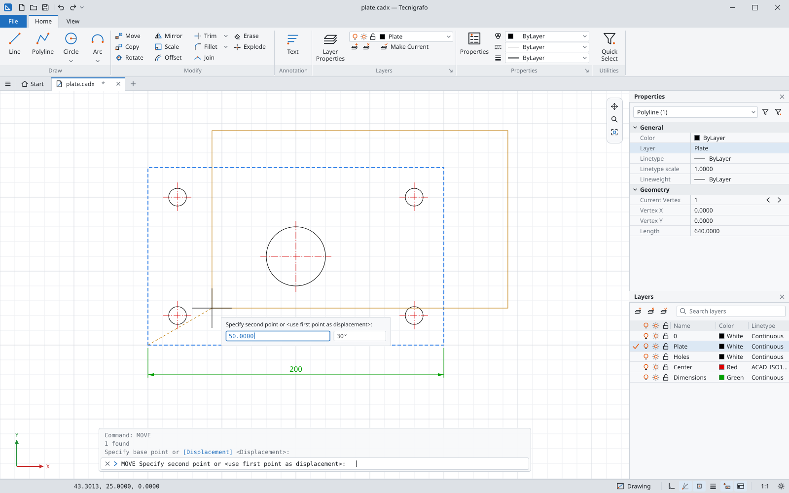
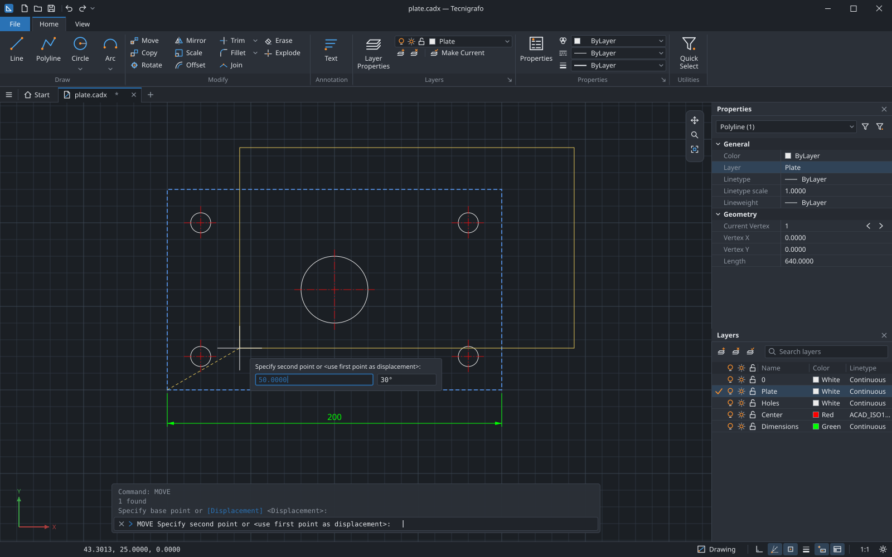
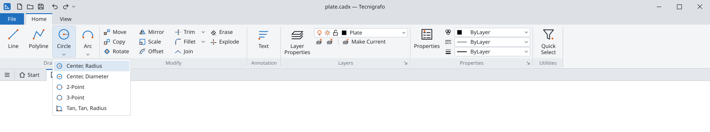
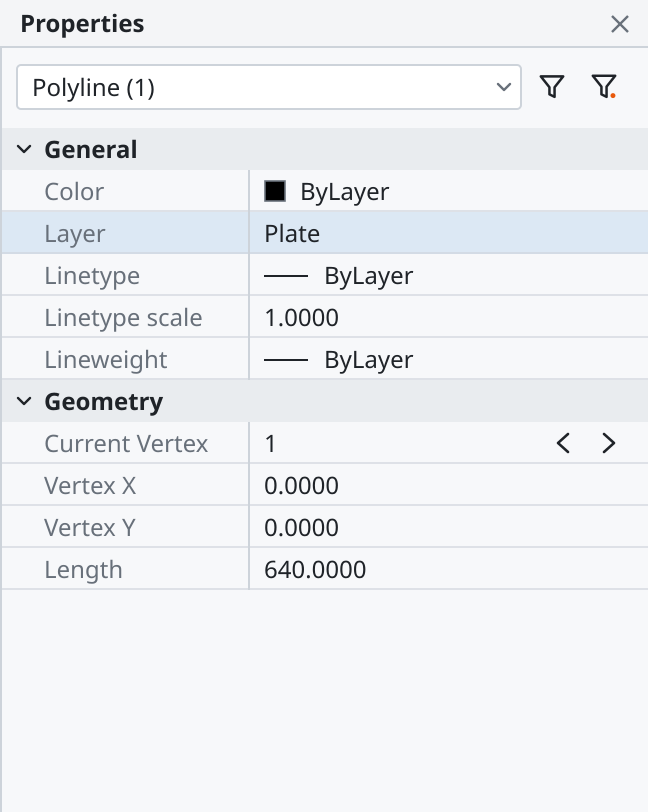
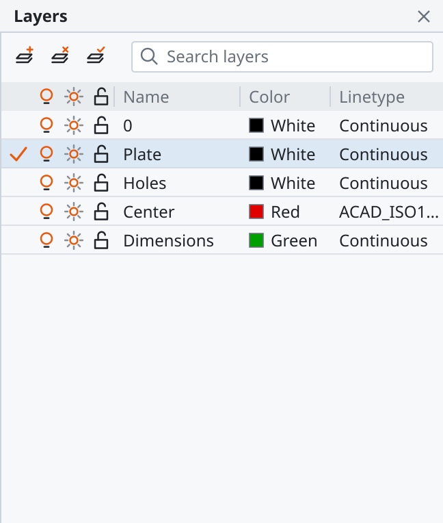
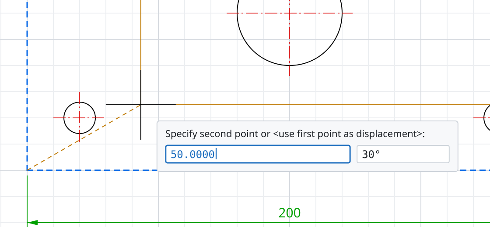
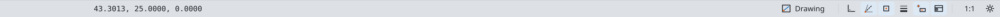

# Manuale dell'interfaccia

Questo manuale descrive l'interfaccia grafica di Tecnigrafo: la barra del titolo con
l'accesso rapido, la scheda *File* e il ribbon compatto con i gruppi e le varianti
dei comandi, la gestione dei documenti in schede e la pagina iniziale *Start*, i
pannelli *Properties* e *Layers* e i pannelli a scomparsa (*Auto-hide*), la riga di
comando mobile e l'immissione dinamica vicino al cursore, e la barra di stato a icone
con l'indicatore dell'ambiente.

Per i comandi da tastiera, la sintassi e gli alias vedi il
[manuale dei comandi](comandi.md).

---

## 1. Barra del titolo, accesso rapido, scheda File e ribbon

Dall'alto verso il basso della finestra principale si trovano la barra del titolo con
la barra di accesso rapido, la riga delle schede con la scheda *File* e il ribbon
compatto organizzato a gruppi logici di comandi.

### Barra del titolo e finestra

La finestra principale utilizza uno stile integrato senza cornice (su sistemi
Windows e Linux con server grafico X11; sui sistemi con compositor Wayland viene
mantenuta la cornice nativa di sistema per garantire il pieno supporto al
posizionamento e al ridimensionamento della finestra):

- **A sinistra:** l'icona dell'applicazione e la **barra di accesso rapido**;
- **Al centro:** l'intestazione con il nome del documento attivo e il programma, ad
  esempio `Drawing1.cadx — Tecnigrafo` (se il documento contiene modifiche non
  salvate compare un asterisco `*` prima del nome: `*Drawing1.cadx — Tecnigrafo`).
  Quando è attiva la pagina iniziale *Start*, il titolo mostra semplicemente
  `Tecnigrafo`;
- **A destra:** i tre controlli standard della finestra (*Riduci a icona*,
  *Massimizza / Ripristina*, *Chiudi*).

### Barra di accesso rapido

La barra di accesso rapido (*Quick Access Toolbar*), situata a sinistra nella fascia
del titolo, raccoglie le azioni usate più di frequente sotto forma di pulsanti a
icona compatti da 16 px, senza etichetta di testo, richiamabili con un singolo clic:

| Icona / Azione | Identificativo | Scorciatoia | Effetto |
|---|---|---|---|
| **New** | `file.new` | `Ctrl+N` | Crea un nuovo documento in una nuova scheda |
| **Open** | `file.open` | `Ctrl+O` | Apre un file esistente in una nuova scheda |
| **Save** | `file.save` | `Ctrl+S` | Salva il documento attivo (`QSAVE`) |
| **Undo** | `edit.undo` | `Ctrl+Z` | Annulla l'ultima operazione eseguita |
| **Redo** | `edit.redo` | `Ctrl+Y` / `Ctrl+Shift+Z` | Ripristina l'operazione precedentemente annullata |

La barra di accesso rapido è sempre visibile e operativa, sia quando si utilizza la
barra multifunzione (*ribbon*) sia quando si passa all'interfaccia classica a menu e
barre degli strumenti.

### Scheda File

A sinistra della riga delle schede del ribbon si trova la scheda **File**,
immediatamente riconoscibile dal fondo pieno nel colore d'accento del programma
(`accent`) con testo chiaro.

Facendo clic sulla scheda *File* si apre il menu principale dell'applicazione, che
dà accesso alle operazioni globali e di gestione dei file:

- **New** (`Ctrl+N`): crea un nuovo documento;
- **Open…** (`Ctrl+O`): apre un documento da disco;
- **Save** (`Ctrl+S`): salva rapidamente il documento attivo;
- **Save As…** (`Ctrl+Shift+S`): salva con un nuovo nome di file;
- **Recent Files:** sottomenu con l'elenco degli ultimi file aperti per una rapida riapertura;
- **Settings…:** apre la finestra di configurazione generale dell'applicazione;
- **Customize Shortcuts…:** apre la finestra di personalizzazione delle scorciatoie;
- **About Tecnigrafo:** mostra la finestra informativa con la versione e le licenze;
- **Exit:** chiude tutti i documenti e termina l'applicazione.

### Ribbon compatto e gruppi di comandi

Il ribbon adotta una disposizione compatta che elimina ogni spazio vuoto superfluo
sopra le schede. La scheda correntemente aperta è evidenziata da un bordo superiore
nel colore d'accento e dal fondo coordinato con l'area dei comandi.

Nella scheda **Home** i comandi sono raggruppati per funzione logica:

- **Draw:** strumenti per la creazione di nuove entità grafiche (`Line`, `Polyline`,
  `Circle`, `Arc`, `Text`);
- **Modify:** comandi di modifica e manipolazione (`Move`, `Copy`, `Rotate`, `Scale`,
  `Mirror`, `Trim`, `Extend`, `Fillet`, `Chamfer`, `Join`, `Explode`, `Erase`);
- **Annotation:** comandi di testo e annotazione (`Text`);
- **Layers:** controlli rapidi per la gestione dei layer (il menu a tendina
  `LayerCombo` e il pulsante per aprire il pannello *Layer Properties*);
- **Properties:** controlli per il colore, il tipo di linea e lo spessore correnti
  o degli oggetti selezionati, oltre al pulsante per aprire il pannello *Properties*;
- **Utilities:** strumenti di selezione rapida (*Quick Select*).

Ciascun gruppo mostra il proprio nome in una fascia inferiore nel colore del testo
secondario (`text.secondary`).

La disposizione all'interno dei gruppi combina:
- **Pulsanti grandi:** icona principale da 32 px con etichetta descrittiva sottostante,
  usati per i comandi cardine di disegno e modifica;
- **Pile di tre pulsanti piccoli:** icone da 16 px disposte in colonna, affiancate
  dal testo o con la sola icona, per massimizzare la densità visiva;
- **Pulsanti a riposo privi di cornice:** i pulsanti non presentano bordi fissi a riposo;
  il bordo e lo sfondo di selezione (`selection`) appaiono in modo fluido al passaggio
  del puntatore (*hover*) o quando il pulsante viene premuto.

Nel gruppo *Layers*, la casella combinata rapida dei layer (`LayerCombo`) mostra per
ogni voce le icone di stato (acceso/spento, scongelato/congelato, sbloccato/bloccato),
il campione del colore associato e il nome del layer.

Nel gruppo *Properties*, le tre caselle combinate permettono di scegliere
direttamente il colore, il tipo di linea e lo spessore corrente (o di applicarli agli
oggetti selezionati), visualizzando a sinistra il rispettivo campione visivo.

### Varianti dei comandi (le cinque di CIRCLE)

I comandi geometrici che dispongono di più metodi costruttivi presentano una
freccetta verso il basso nel pulsante del ribbon. Cliccando sulla freccetta si apre un
menu a tendina con tutte le varianti disponibili, ciascuna contrassegnata dalla
propria icona a ruoli e dal nome descrittivo. Il pulsante ricorda l'ultima variante
usata: cliccando direttamente sulla parte principale del pulsante viene avviata
immediatamente l'ultima variante scelta.

Il comando **`CIRCLE`** dispone di cinque varianti:

1. **Center, Radius:** richiede il centro e successivamente il valore del raggio
   (corrisponde alla sintassi base di `CIRCLE`);
2. **Center, Diameter:** richiede il centro e passa automaticamente all'opzione
   diametro (invia `D` alla seconda richiesta);
3. **2-Point:** costruisce il cerchio indicando i due estremi del diametro
   (invia l'opzione `2P`);
4. **3-Point:** costruisce il cerchio passante per tre punti sulla circonferenza
   (invia l'opzione `3P`);
5. **Tan, Tan, Radius:** costruisce il cerchio tangente a due entità esistenti con un
   raggio assegnato (invia l'opzione `T`).

Anche il comando **`ARC`** offre varianti dedicate:
- **3-Point:** arco passante per tre punti;
- **Start, Center, End:** arco definito da punto iniziale, centro e punto finale
  (invia l'opzione `C` al secondo passaggio).

Nell'interfaccia classica le medesime varianti sono accessibili tramite i sottomenu
corrispondenti (ad esempio *Draw → Circle* e *Draw → Arc*).

### Passare all'interfaccia classica

È possibile passare in qualsiasi momento dall'interfaccia a barra multifunzione a
quella classica a menu e barre degli strumenti (*Standard*, *Draw*, *Modify*,
*Layers*, *Properties*):

- Cliccando sull'interruttore a icona **Ribbon** (`ui-ribbon`) all'estrema destra
  della barra di stato;
- Digitando il comando `RIBBONCLOSE` per l'interfaccia classica, oppure `RIBBON` per
  ripristinare la barra multifunzione;
- Dalla finestra *Tools → Settings*, impostando la voce *Interface* su *Classic* o
  *Ribbon*.

L'impostazione scelta viene salvata nelle preferenze utente e conservata al riavvio.

---

## 2. Schede dei documenti e pagina iniziale Start

La riga delle schede dei documenti, situata immediatamente sotto il ribbon (o sotto
le barre degli strumenti nell'interfaccia classica), consente di visualizzare e
gestire più disegni aperti all'interno della stessa finestra.

### Riga delle schede dei documenti

La barra delle schede comprende:

- **Pulsante del menu dei documenti:** all'estrema sinistra, un pulsante con icona
  che apre un menu a discesa con l'elenco di tutte le sessioni aperte, utile per
  selezionare rapidamente un documento anche quando vi sono molte schede;
- **Scheda fissa Start:** sempre presente come prima scheda;
- **Schede dei documenti:** una scheda per ciascun documento aperto, recante l'icona
  del tipo di file (es. disegno), il nome del documento, un asterisco `*` se il
  documento è stato modificato rispetto all'ultimo salvataggio, e la crocetta (`×`)
  per la chiusura;
- **Pulsante `+`:** all'estrema destra delle schede, permette di creare
  istantaneamente un nuovo documento vuoto (`NEW`).

### Pagina iniziale Start

All'avvio dell'applicazione, Tecnigrafo si apre per impostazione predefinita sulla
pagina iniziale **Start**, senza alcun documento aperto (come in AutoCAD):

- Mostra i pulsanti **New** per creare un nuovo documento (un pulsante per ogni tipo
  registrato nel programma, ad esempio *Drawing* per file `.cadx` e `.dxf`);
- Mostra il pulsante **Open…** per aprire un file esistente da disco;
- Mostra la lista interattiva dei documenti aperti di recente (**Recent Files**),
  completi di percorso e data di modifica.

Quando la scheda *Start* è attiva:
- L'area di disegno, la riga di comando e i pannelli laterali non sono collegati ad
  alcuna sessione attiva;
- Tutte le azioni e i comandi che richiedono un documento (comandi di disegno,
  modifica, *Save*, *Undo*, *Redo* e relative scorciatoie) sono automaticamente
  disattivati;
- Rimangono abilitate le sole azioni globali del programma: creazione e apertura di
  documenti, cronologia dei recenti, impostazioni, personalizzazione delle
  scorciatoie, cambio del tema e dell'interfaccia, informazioni sul programma e uscita.

### Passaggio da un documento all'altro (Contratto di attivazione)

Ogni documento aperto possiede una propria **sessione** del tutto autonoma e isolata,
composta dal documento geometrico, dalla cronologia completa delle operazioni di
annullamento e ripristino, dal runner dei comandi, dallo stato della vista grafica
(centro e livello di zoom) e dal file su disco.

Quando si fa clic sulla scheda di un documento per attivarla:
- Vista di disegno, riga di comando con la sua cronologia, pannelli *Layers* e
  *Properties*, barra di stato e comandi di annullamento e ripetizione seguono
  immediatamente la sessione del documento selezionato;
- **Nessuna operazione viene interrotta o annullata:** se in un documento è in corso
  un comando (ad esempio `LINE` in attesa del secondo punto, oppure un testo parziale
  digitato nella riga di comando o nell'immissione dinamica prima di premere `Invio`),
  il comando rimane esattamente nello stato in cui si trova all'interno della sua
  sessione. Tornando sulla scheda di quel documento, il comando riprende dal punto
  esatto in cui era stato lasciato sospeso;
- L'apertura di un file già aperto non crea un duplicato, ma sposta il fuoco e attiva
  la scheda esistente di quel file.

### Richiesta di un ambiente non ospitato dal documento attivo

Ogni tipo di documento dichiara quali ambienti può ospitare (il tipo disegno 2D
ospita l'ambiente `drawing2d`).

Dall'indicatore dell'ambiente presente nella barra di stato è possibile scegliere un
qualsiasi ambiente tra quelli registrati. Se l'utente richiede un ambiente che il
documento attivo **non può ospitare** (o se lo richiede mentre si trova sulla pagina
*Start*):

- Il documento attivo **rimane aperto nella sua scheda**, così com'è, conservando
  l'eventuale comando in corso: **niente si chiude e non viene richiesto alcun
  salvataggio**;
- Il programma crea un nuovo documento del tipo corrispondente all'ambiente scelto in
  una **scheda nuova**, che diventa attiva nell'ambiente richiesto;
- Se più tipi di documento registrati sono in grado di ospitare quell'ambiente, una
  finestra di dialogo consente all'utente di scegliere quale tipo creare;
- Anche qualora vi sia già una scheda aperta del tipo richiesto, la richiesta crea
  comunque un nuovo documento, interpretando la scelta dell'utente come la volontà di
  aprire una nuova sessione di lavoro.

### Quando il programma chiede di salvare

Poiché i comandi `NEW` e `OPEN` aprono sempre un nuovo documento in una nuova scheda
lasciando intatti i documenti già aperti, essi non chiedono mai di salvare.

La richiesta di salvare il lavoro (*Save changes to <documento>? [Yes/No/Cancel]*)
viene presentata **esclusivamente quando un documento modificato viene chiuso
davvero**:

1. **Chiusura di una singola scheda:** facendo clic sulla crocetta (`×`) di una
   scheda modificata, compare la richiesta di salvataggio:
   - *Yes / Save:* salva il documento e chiude la scheda (se il file non ha ancora un
     nome viene aperta la finestra di dialogo; se il salvataggio fallisce o viene
     annullato, la scheda resta aperta);
   - *No / Discard:* scarta le modifiche non salvate e chiude la scheda;
   - *Cancel:* interrompe l'operazione e lascia la scheda aperta e modificata.
2. **Chiusura della finestra principale:** se si chiude l'applicazione mentre sono
   presenti documenti modificati, Tecnigrafo esamina i documenti nell'ordine delle
   schede e chiede conferma per ciascuno di essi in successione. Se per uno qualunque
   dei documenti si preme *Cancel*, l'intera chiusura dell'applicazione viene
   interrotta: i documenti per i quali è già stata confermata la chiusura rimangono
   chiusi, mentre il documento corrente e tutti i successivi restano aperti, e la
   finestra rimane aperta.

**Quale scheda diventa attiva alla chiusura:** quando viene chiusa la scheda attiva,
diventa attiva la scheda di documento situata alla sua **destra**; se non ve ne sono a
destra, diventa attiva quella alla sua **sinistra**; se vengono chiusi tutti i
documenti, il programma mostra la pagina **Start**. Chiudere una scheda che non è
quella attiva non modifica la scheda correntemente visualizzata.

---

## 3. Pannelli Properties e Layers e pannelli a scomparsa (Auto-hide)

I pannelli degli strumenti offrono controlli interattivi avanzati e possono essere
agganciati ai quattro bordi della finestra principale, raggruppati a schede
sovrapponendoli, staccati come finestre mobili (*floating*) oppure configurati per
nascondersi automaticamente.

### Il pannello delle proprietà (PROPERTIES)

Si apre digitando il comando `PROPERTIES` (o gli alias `PR`, `CH`, `MO`, `PROPS`),
oppure premendo il pulsante dedicato nel gruppo *Properties* del ribbon o dal menu
*Modify*.

Il pannello è organizzato in una struttura chiara e compatta:

- **In alto:** casella combinata di selezione che indica il tipo e il numero di
  oggetti selezionati (es. `Line`, `Circle`, `Polyline`, `All (3)`, oppure
  `No selection`), affiancata da due pulsanti a icona per il filtro rapido e per
  l'apertura della finestra di selezione rapida (*Quick Select*);
- **Sotto:** **griglia compatta a due colonne** (`QTreeView`) con righe di altezza
  ottimizzata da 20–22 px. Il nome della proprietà è riportato nella colonna di
  sinistra nel colore secondario, mentre il valore modificabile si trova nella colonna
  di destra;
- **Gruppi comprimibili ed espandibili:**
  - **General:** elenca le proprietà generali dell'entità (*Color*, *Layer*,
    *Linetype*, *Linetype scale*, *Lineweight*). Ciascuna proprietà si modifica
    direttamente nella cella tramite editor dedicati (palette colori, casella dei layer
    con icone di stato, ecc.). Se la selezione contiene oggetti con valori
    disomogenei, il campo mostra `*VARIES*`. In assenza di selezione, il pannello
    consente di impostare le proprietà correnti del disegno per le nuove entità.
  - **Geometry (in sola lettura):** visualizza le coordinate e le dimensioni
    geometriche fondamentali dell'oggetto selezionato (es. estremi per una linea,
    centro e raggio per un cerchio). Nel caso di una polilinea (`LWPOLYLINE`), include
    il controllo di **scorrimento dei vertici**: la voce *Current Vertex* dispone di
    due frecce per passare al vertice precedente o successivo, visualizzando nei campi
    *Vertex X* e *Vertex Y* le coordinate del vertice scelto, seguite dalla lunghezza
    complessiva della polilinea.

Ogni modifica effettuata nel pannello costituisce una transazione `Properties`
annullabile con `Ctrl+Z`. Le entità appartenenti a layer bloccati vengono protette e
non possono essere modificate dal pannello.

### Il pannello dei layer (LAYER)

Si apre con il comando `LAYER` (o l'alias `LA`), oppure cliccando sul pulsante *Layer
Properties* nel gruppo *Layers* del ribbon o nella barra degli strumenti classica.

Il pannello comprende:

- **Barra degli strumenti a icone:**
  - **New Layer:** crea un nuovo layer (con nome progressivo `Layer1`, `Layer2`, …)
    ereditando i valori predefiniti del layer `0`;
  - **Delete Layer:** cancella il layer selezionato (l'eliminazione è rifiutata per il
    layer `0`, per il layer corrente e per i layer contenenti entità);
  - **Set Current:** imposta il layer selezionato come layer di lavoro attivo.
- **Campo di ricerca:** posizionato accanto ai pulsanti, permette di filtrare
  istantaneamente le righe della tabella digitando parte del nome del layer;
- **Tabella compatta (righe da 20–22 px):**
  - **Stato (spunta verde):** contrassegna il layer correntemente attivo;
  - **Colonne a icone di stato:** *On/Off* (lampadina), *Freeze/Thaw* (fiocco di
    neve / sole), *Lock/Unlock* (lucchetto). Cliccando direttamente sull'icona nella
    riga si commuta istantaneamente lo stato del layer;
  - **Colonne di testo:** *Name* (doppio clic per rinominare), *Color* (mostra il
    campione del colore e il nome o indice numerico ACI; un clic apre il selettore
    colore), *Linetype* (menu a tendina con i tipi di linea caricati), *Lineweight*
    (spessore di linea assegnato) e *Plot* (icona della stampante per abilitare o
    disabilitare la stampa).
  - La tabella è dimensionata per evitare barre di scorrimento orizzontali quando le
    colonne rientrano nella larghezza del pannello.

Tutte le operazioni nel pannello generano transazioni `Layer` annullabili con
`Ctrl+Z` o `U`.

### Pannelli che si nascondono da soli (Auto-hide)

Per lasciare il massimo spazio utile all'area di disegno senza dover chiudere e
riaprire i pannelli, Tecnigrafo offre la funzione di scomparsa automatica
(*Auto-hide*):

- **Puntina (Auto-hide):** nella barra del titolo di ciascun pannello agganciato
  compare l'icona di una puntina da disegno (accanto al titolo e alla crocetta di
  chiusura). I pannelli mobili (staccati) non mostrano la puntina;
- **Nascondere:** facendo clic sulla puntina per toglierla, il pannello si ritrae e sul
  bordo della finestra in cui era agganciato (sinistro, destro o inferiore) compare una
  **linguetta** compatta recante l'icona e il nome del pannello (orientata in
  verticale sui lati, in orizzontale sul bordo inferiore). Più pannelli nascosti sullo
  stesso bordo vengono raggruppati nella medesima barra delle linguette. L'area di
  disegno si espande occupando tutto lo spazio liberato;
- **Mostrare:** quando il puntatore del mouse si sofferma su una linguetta (oppure con
  un clic), il pannello riappare aprendosi in un **riquadro sovrapposto** all'area di
  disegno, mantenendo la sua larghezza originale e l'intera altezza disponibile, senza
  modificare la vista grafica sottostante;
- **Richiudere:** quando il puntatore esce dal riquadro per qualche istante, il
  pannello si richiude automaticamente. Se il fuoco della tastiera si trova
  all'interno di un controllo del pannello (ad esempio mentre si modifica una cella
  della griglia o si scrive nel campo di ricerca dei layer), il riquadro rimane aperto
  finché l'operazione non è conclusa. Il riquadro si richiude anche premendo `Esc` o
  spostando il mouse su un'altra linguetta;
- **Rifissare:** cliccando nuovamente sulla puntina nella barra del riquadro aperto, il
  pannello torna a essere stabilmente agganciato al bordo della finestra;
- **Memorizzazione:** la configurazione dei pannelli nascosti e la loro disposizione sui
  bordi vengono salvate nelle preferenze utente e ripristinate fedelmente a ogni avvio.

---

## 4. Riga di comando e immissione dinamica

L'interazione con i comandi e l'inserimento di coordinate e parametri possono avvenire
tramite la tradizionale riga di comando o direttamente nell'area grafica grazie
all'immissione dinamica vicino al cursore.

### Riga di comando mobile

La riga di comando si trova in basso sopra l'area di disegno:

- Nella parte superiore mostra le ultime righe della **cronologia** dei comandi e dei
  messaggi di sistema;
- Nella parte inferiore presenta la **riga di immissione** con il simbolo di prompt
  (`Command:`), il nome del comando in esecuzione e la richiesta corrente, con le
  opzioni disponibili racchiuse tra parentesi quadre nel colore d'accento (ad esempio
  `[3P/2P/Ttr (tan tan radius)]`);
- Il testo utilizza un carattere a passo fisso per un perfetto allineamento.

La riga di comando costituisce il cuore operativo dell'interprete: qualsiasi comando,
coordinata o opzione digitata vi fa capo in modo diretto e trasparente.

### Immissione dinamica vicino al cursore (Dynamic Input)

L'immissione dinamica consente di visualizzare richieste, digitare quote e inserire
coordinate direttamente accanto al puntatore nell'area di disegno, senza dover
spostare lo sguardo sulla riga di comando.

#### Un solo interprete trasparente

L'immissione dinamica non costituisce un interprete alternativo o separato. Essa si
occupa unicamente di comporre la stringa di testo identica a quella che l'utente
avrebbe digitato sulla riga di comando e la passa al runner dei comandi. Nella
cronologia della riga di comando viene sempre stampata la riga di testo equivalente
(ad esempio `@56.39<61` oppure `100,250`), garantendo assoluta coerenza nei
risultati, riproducibilità e compatibilità con gli script e il canale MCP.

#### Cosa mostra il riquadro

Il riquadro appare in basso a destra rispetto al cursore, mantenendosi sempre entro i
bordi visibili dell'area di disegno:

| Tipo di richiesta in corso | Contenuto del riquadro |
|---|---|
| Richiesta di un punto senza punto base (es. primo punto di `LINE`, centro di `CIRCLE`) | Due campi con le coordinate cartesiane assolute **X** e **Y** |
| Richiesta di un punto con un punto base (es. secondo punto di `LINE`, punto di destinazione in `MOVE`) | Due campi con **lunghezza** e **angolo** relativi rispetto al punto base |
| Richiesta di una misura scalare (distanza, raggio, fattore di scala, valore numerico) | Un singolo campo valore |
| Richiesta di selezione entità o testo letterale | La sola richiesta descrittiva del comando, senza campi numerici |

Sopra i campi è sempre presente il testo della richiesta con le eventuali opzioni tra
parentesi quadre. Il campo attualmente attivo è evidenziato nel colore d'accento
(`accent`). I campi non ancora scritti dall'utente seguono in tempo reale la posizione
del puntatore del mouse.

#### Come si usa

1. **Scrivere un numero blocca il campo:** digitando cifre, un segno meno o un punto
   decimale, il valore viene inserito nel campo attivo e questo si **blocca**: il
   movimento del mouse non modificherà più quel parametro;
2. **Tasto `Tab`:** premendo `Tab` ci si sposta ciclicamente al campo successivo,
   bloccando il valore digitato in quello precedente;
3. **Virgola per coordinate cartesiane:** durante l'inserimento con punto base (dove i
   campi predefiniti sono lunghezza e angolo), digitando una virgola `,` nel campo
   della lunghezza si commuta all'inserimento cartesiano relativo `@<dx>,<dy>`;
4. **Campo bloccato e campo libero:** se un campo è bloccato e l'altro è libero, al
   momento della conferma il campo libero acquisisce automaticamente il valore dato
   dalla posizione del cursore, già corretto dagli snap a oggetto, dalla modalità orto o
   dal tracciamento polare;
5. **Tasto `Invio`:** conferma l'immissione e invia la risposta. Se non è stato
   digitato alcun valore nei campi, premere `Invio` equivale a inviare una riga vuota
   alla riga di comando (utile ad esempio per terminare comandi sequenziali come `LINE` o
   `PLINE`);
6. **Lettere e opzioni:** digitando una lettera alfabetica (per richiamare un'opzione o
   un nuovo comando), il fuoco passa automaticamente alla riga di comando principale;
7. **Tasto `Esc`:** annulla la richiesta corrente esattamente come sulla riga di
   comando.

#### Attivazione e scorciatoia F12

L'immissione dinamica è attiva per impostazione predefinita. Si attiva e disattiva:
- Premendo il tasto funzione **`F12`** sulla tastiera;
- Cliccando sull'interruttore a icona **DYN** (`aids-dynmode`) nella barra di stato.

Nello storico della riga di comando compare il messaggio `<Dynamic input on>` oppure
`<Dynamic input off>`. Lo stato viene memorizzato nelle preferenze dell'applicazione.

---

## 5. Barra di stato

La barra di stato, situata sul bordo inferiore della finestra principale, fornisce
informazioni continue sulla vista e pulsanti rapidi per controllare tutte le modalità
di disegno e l'ambiente.

### Coordinate del puntatore

All'estrema sinistra della barra di stato compaiono le coordinate cartesiane correnti
del puntatore (`X, Y, Z`) espresse in unità di disegno e formattate a quattro cifre
decimali, aggiornate in tempo reale a ogni spostamento del mouse.

Accanto alle coordinate è riservato lo spazio per le future schede degli spazi
*Model* e *Layout*.

### Indicatore dell'ambiente

A destra delle coordinate si trova l'**indicatore dell'ambiente**: mostra l'icona e il
nome dell'ambiente di lavoro attivo (ad esempio l'icona `env-drawing2d` e il nome
`Drawing`).

Facendo clic sull'indicatore si apre un menu popup con l'elenco di tutti gli ambienti
registrati nell'applicazione:
- L'ambiente attivo è contrassegnato da un segno di spunta;
- Scegliere un ambiente compatibile con il tipo di documento corrente commuta
  l'ambiente di lavoro mantenendo il documento attivo;
- Scegliere un ambiente non supportato dal documento corrente (o sceglierlo mentre è
  attiva la pagina *Start*) crea automaticamente un nuovo documento del tipo
  appropriato in una nuova scheda, senza chiudere né modificare il lavoro precedente;
- Con la pagina *Start* attiva l'indicatore mostra il menu permettendo di scegliere
  l'ambiente di partenza.

### Interruttori delle modalità di disegno e aiuti

Al centro-destra della barra di stato sono disposti gli interruttori a icona per gli
aiuti al disegno e le impostazioni dell'interfaccia. Ciascun interruttore è un
pulsante compatto a icona: quando la modalità è attiva, il pulsante assume lo sfondo
colorato di selezione (`selection`). Posizionando il puntatore sopra il pulsante appare
il suggerimento (*tooltip*) con il nome completo e la relativa scorciatoia:

| Icona / Interruttore | Tasto / Azione | Modalità controllata |
|---|---|---|
| **ORTHO** | `F8` | Modalità ortogonale: vincola il puntatore a movimenti rigorosamente orizzontali o verticali |
| **POLAR** | `F10` | Tracciamento polare: proietta guide e allineamenti ad angoli incrementali (`POLARANG`) |
| **OSNAP** | `F3` | Snap ad oggetto: aggancio geometrico ai punti notevoli delle entità |
| **LWT** | `LWDISPLAY` | Visualizzazione spessori: mostra a schermo gli spessori reali delle linee anziché un tratto uniforme |
| **DYN** | `F12` | Immissione dinamica: attiva il riquadro con richieste e campi numerici vicino al cursore |
| **RIBBON** | `ui.interface` | Alterna la visualizzazione tra la barra multifunzione (*ribbon*) e l'interfaccia classica |

### Scala e impostazioni

All'estrema destra della barra di stato si trovano:
- **Indicatore della scala:** etichetta che riporta il fattore di zoom o la scala di
  visualizzazione attiva della vista;
- **Pulsante Impostazioni (`ui-settings`):** pulsante a icona con ingranaggio per
  aprire rapidamente la finestra delle preferenze generali di Tecnigrafo
  (*Tools → Settings*).

---

## Selezione rapida (QSELECT)

La finestra di dialogo **Quick Select** consente di comporre selezioni di oggetti basate
su criteri e filtri di proprietà. Si apre con il comando `QSELECT`, dal pulsante nel gruppo
*Utilities* del ribbon, dai pulsanti di testata del pannello *Properties* o dal menu *Edit*.

Opzioni della finestra:
- **Apply to**: definisce il dominio di ricerca:
  - *Entire drawing*: applica il filtro a tutti gli oggetti del disegno;
  - *Current selection*: restringe la ricerca alle sole entità già selezionate.
- **Object type**: filtra per tipo di oggetto (*All*, *Line*, *Circle*, *Arc*, *Polyline*, *Text*).
- **Properties**: proprietà da verificare (*Layer*, *Color*, *Linetype*, *Lineweight*).
- **Operator**: operatore di confronto:
  - `= Equals`: seleziona le entità con valore uguale a quello specificato;
  - `≠ Not Equal`: seleziona le entità con valore diverso da quello specificato.
- **Value**: valore da ricercare (inseribile con il controllo dedicato a ciascun tipo di proprietà).
- **How to apply**:
  - *Include in new selection set*: inserisce nella selezione le entità che soddisfano la condizione;
  - *Exclude from new selection set*: inserisce nella selezione le entità che non soddisfano la condizione.

Alla conferma con **OK**, la selezione attiva nel disegno viene aggiornata e la riga di
comando segnala il totale degli elementi selezionati (`<n> item(s) selected.`). Le entità
su layer spenti, congelati o bloccati vengono escluse automaticamente.

---

## Finestra di selezione chiusa trascinando

Il rettangolo di selezione nell'area di disegno si può creare sia con la tradizionale
tecnica a due clic separati, sia tenendo premuto e trascinando il mouse:

- **Clic fermo (spostamento inferiore a 5 pixel):** premendo e rilasciando il tasto
  sinistro del mouse nella stessa posizione, il rettangolo di selezione si apre e
  rimane attivo seguendo il puntatore; un secondo clic nella vista fissa l'angolo
  opposto e conclude la selezione.
- **Pressione, trascinamento e rilascio:** premendo il tasto sinistro nel vuoto e
  trascinando il puntatore oltre la soglia di 5 pixel, il rilascio del tasto vale come
  secondo clic e chiude immediatamente il rettangolo di selezione.

In entrambe le modalità valgono le regole standard della selezione a rettangolo:

- **Verso destra (finestra):** sfondo azzurro trasparente con bordo continuo; seleziona
  solo le entità interamente contenute all'interno dell'area.
- **Verso sinistra (intersezione):** sfondo verde trasparente con bordo tratteggiato;
  seleziona tutte le entità contenute o attraversate dal contorno del rettangolo.
- **Tasto `Shift`:** tenendo premuto `Shift` al momento del rilascio (o del secondo clic),
  gli oggetti individuati vengono rimossi dalla selezione anziché aggiunti.
- **Tasto `Esc`:** premuto con un rettangolo aperto, chiude e annulla il rettangolo
  senza modificare la selezione precedente.

---

## Grip: modifica diretta delle entità

I grip sono quadratini blu (10 pixel di lato a schermo) che compaiono sui vertici e
sui punti notevoli delle entità quando queste sono selezionate nell'area di disegno
senza alcun comando in corso (*selezione a riposo*).

Se la selezione contiene più di 100 entità (come la variabile `GRIPOBJLIMIT`
in AutoCAD), i grip non vengono disegnati a schermo per preservare la fluidità grafica.

### Dove si trovano

| Entità | Posizione dei grip |
|---|---|
| `LINE` | I due estremi e il punto medio |
| `ARC` | I due estremi, il punto medio (sull'arco) e il centro |
| `CIRCLE` | Il centro e i quattro quadranti (a 0°, 90°, 180° e 270°) |
| `LWPOLYLINE` | Ciascun vertice e il punto medio di ogni segmento (sull'arco per i segmenti curvi) |
| `TEXT` | Il punto d'inserimento (sulla linea di base); per allineamenti *Aligned* e *Fit*, anche il secondo punto di allineamento |

### Come si usano

1. Fai clic con il tasto sinistro entro il quadrato di un grip (con tolleranza di 5 pixel
   dal centro): il grip diventa **caldo** (*hot grip*) e si colora di rosso;
2. Sulla riga di comando compare l'intestazione `** STRETCH **` e la domanda
   `Specify stretch point:`;
3. Gli aiuti al disegno (snap a oggetto, modalità orto e tracciamento polare) usano la
   posizione iniziale del grip caldo come punto base;
4. L'anteprima dinamica mostra l'entità deformata o spostata mentre muovi il puntatore;
5. Indica il nuovo punto cliccando nella vista o digitando le coordinate sulla riga di
   comando o nell'immissione dinamica: l'entità viene aggiornata con un passo di
   annullamento `Grip edit`;
6. Se la nuova posizione genera una geometria degenere (es. raggio nullo o punti
   coincidenti), compare il messaggio `Invalid grip edit.` e l'entità resta invariata;
7. Premendo `Esc` sul grip caldo si abbandona l'operazione senza modificare l'entità;
8. Un ulteriore tasto `Esc` a riposo deseleziona gli oggetti e nasconde i grip.

---

## Temi dell'interfaccia

Tecnigrafo dispone di due temi completi coordinati basati sullo stile Qt Fusion e
definiti da un sistema a gettoni cromatici:

- **Chiaro (Light):** area di disegno con sfondo bianco (`surface.canvas`), controlli e
  superfici chiare. Il colore convenzionale CAD 7 (bianco/nero) viene disegnato in nero;
- **Scuro (Dark):** area di disegno con sfondo scuro (`surface.canvas`), superfici
  scure a basso contrasto per ridurre l'affaticamento visivo. Il colore 7 viene disegnato
  in bianco.

### Cambiare tema

- Dal menu *View → Theme → Light* o *Dark*;
- Dalla finestra *Tools → Settings*, selezionando il tema desiderato.

Il cambio di tema aggiorna istantaneamente l'intera finestra: tavolozza di colori,
sfondo della vista e tutte le icone a ruoli, garantendo ottima leggibilità in ogni
condizione. La scelta viene salvata nelle preferenze utente.

---

## Personalizzazione delle scorciatoie da tastiera

La finestra **Customize Shortcuts** permette di esaminare, riassegnare ed esportare le
scorciatoie da tastiera associate alle azioni del programma. Si apre dalla scheda *File*,
dal menu classico *Tools → Customize Shortcuts...* o dalle impostazioni.

Caratteristiche:
- **Elenco completo delle azioni:** tabella con nome dell'azione, descrizione estesa, combinazione
  di tasti attiva e combinazione predefinita;
- **Filtro di ricerca:** campo testo per filtrare rapidamente le azioni in base a parole chiave;
- **Rilevamento conflitti:** se la sequenza di tasti digitata è già impiegata da un'altra azione
  nel medesimo contesto, il programma segnala il conflitto e impedisce l'assegnazione non valida;
- **Importazione ed esportazione:** possibilità di salvare e caricare configurazioni personalizzate
  in formato testo (`.txt`).

---

## Snap a intersezione, tangente, perpendicolare e quadrante

Lo snap a oggetto geometrico comprende otto modalità di aggancio ai punti notevoli:

| Modo | Azione / Menu *Tools → Object Snap Modes* | Punto di aggancio | Marcatore a schermo |
|---|---|---|---|
| *Endpoint* | `aids.snap.endpoint` | Estremi di linee, archi e vertici di polilinee | Quadrato |
| *Midpoint* | `aids.snap.midpoint` | Punto medio di segmenti e archi | Triangolo |
| *Center* | `aids.snap.center` | Centro geometrico di cerchi e archi | Cerchio |
| *Insertion* | `aids.snap.insertion` | Punto di inserimento sulla linea di base del testo | Due quadrati sovrapposti |
| *Intersection* | `aids.snap.intersection` | Punto d'incontro tra due curve o segmenti entro l'apertura | Croce a forma di X |
| *Perpendicular* | `aids.snap.perpendicular` | Piede della perpendicolare dal punto base alla curva | Simbolo perpendicolare (⊥) |
| *Tangent* | `aids.snap.tangent` | Punto di tangenza dal punto base a cerchi o archi | Cerchio con linea tangente in alto |
| *Quadrant* | `aids.snap.quadrant` | Punti cardinali (0°, 90°, 180°, 270°) di cerchi e archi | Rombo |

Tutti i candidati entro l'apertura di 10 pixel competono tra loro e viene selezionato il
più vicino al puntatore. Lo snap si attiva con il tasto funzione `F3` o con
l'interruttore a icona `OSNAP` nella barra di stato.

---

## Tracciamento polare (POLAR)

Il tracciamento polare proietta linee guida allineate ad angoli regolari a partire dal
punto base del comando o dal grip caldo:

- Si attiva con il tasto funzione **`F10`**, dal menu *Tools → Polar Tracking*, oppure
  cliccando sull'interruttore a icona **POLAR** nella barra di stato;
- È a esclusione reciproca con la modalità ortogonale: attivare `POLAR` (`F10`) disattiva
  automaticamente `ORTHO` (`F8`), e viceversa;
- Quando il puntatore si aggancia a una linea polare compare una semiretta tratteggiata
  e un suggerimento con distanza e angolo (`Polar: <distanza> < <angolo>°`);
- L'incremento angolare predefinito è di 90° e può essere modificato con il comando
  `POLARANG` (ad esempio a 45°, 30° o 15°).

---

## Visualizzazione dello spessore delle linee (LWT)

L'interruttore a icona **LWT** nella barra di stato (corrispondente al comando `LWDISPLAY`
e all'azione `aids.lwdisplay`) attiva o disattiva la visualizzazione dello spessore
effettivo delle linee nella vista:

- **Attivo (`ON`):** linee, polilinee, archi e cerchi vengono disegnati con il loro
  spessore reale espresso in millimetri (inclusi quelli ereditati da `ByLayer`);
- **Disattivato (`OFF`):** tutte le entità vengono renderizzate con uno spessore nominale
  minimo uniforme a schermo (1 pixel logico).

---

Vedi anche:
- [Manuale dei comandi](comandi.md) — comandi da tastiera, sintassi ed esempi.
- [Architettura](../ARCHITETTURA.md) — organizzazione dei moduli e componenti grafici.
